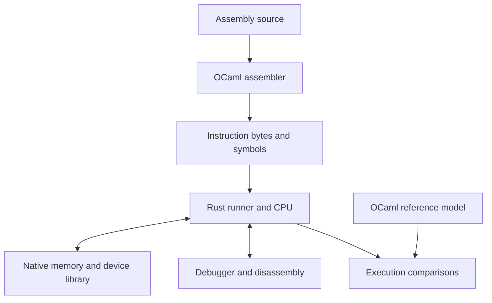

# Project context

 

[Documentation](README.md) · [Decision state](status.md) · [Machine specification](first-machine.md)

## Purpose

Understand computers through research, hand-written implementations, experiments, and investigation of failures. CPU architecture, instruction encoding, memory, and low-level software are central interests. The initial 8-bit limitation has been dropped.

This is a personal experimentation project. Its purpose is technical exploration and understanding through building, rather than an educational platform for other people.

## Current requirements

- Begin with one machine targeting RISC-V RV32I; see [ADR 0004](decisions/0004-first-isa-rv32i.md). The first full MVP requires complete base instruction support; see [ADR 0006](decisions/0006-full-rv32i-coverage.md).
- Initially accept assembly programs. Assembly is converted to encoded instructions before CPU execution; the CLI may combine these steps.
- The assembler emits a raw binary and separate symbol information. The host loads the image and establishes the initial state and PC; no guest boot ROM is required for the MVP.
- Misaligned halfword/word data accesses report traps to the host/debugger. Concrete error-reporting details and other access-fault rules remain to be specified.
- RAM capacity is configurable with a 64 KiB default. The RAM base address is not yet selected.
- The first RV32I machine uses little-endian data and instruction bytes, independently of host byte order; see [ADR 0010](decisions/0010-first-machine-little-endian.md).
- All integer registers initially contain zero; x0 remains zero throughout execution. Set the PC separately to the entry address. Guest programs establish their own stack pointer and calling conventions; see [ADR 0009](decisions/0009-initial-register-state.md).
- Use Rust, OCaml, and C3 in the first full MVP. C3 is selected for the native memory/device subsystem; see [ADR 0001](decisions/0001-native-subsystem-c3.md).
- Use the languages in the emulator and host tools. Compiling high-level guest programs is not an initial requirement.
- Start with instruction-level execution. Microarchitecture and timing are separate future experiments.
- Include inspection tools. Begin formal verification with one proof experiment, then decide its required scope for the first full MVP.
- Provide a terminal UI with register and memory panels. The UI library and panel layout remain open.
- Prioritize manageable implementation complexity. Build small working subsets on the way to complete base instruction support.
- Build and run locally; cloud services are not required.
- Support Linux and macOS in the first MVP, each on x86_64 and ARM64. Exact operating-system and compiler versions remain open; see [ADR 0005](decisions/0005-host-architectures.md).

## Proposed component boundaries

| Component | Proposed language | Responsibility |
| --- | --- | --- |
| CPU and execution controls | Rust | State, decode, instruction semantics, stepping, runner, debugger |
| Memory and virtual hardware | C3 | RAM/ROM, address mapping, image placement, minimal devices |
| Toolchain and reference model | OCaml | Assembler, disassembler, symbols, simple reference execution |

Proposed integration: a narrow C ABI between Rust and the native subsystem; separate OCaml executables communicating through files or process I/O. These interfaces still need a design decision. A C ABI does not require the subsystem to be implemented in C.

The OCaml reference model should use an independent, simple memory representation. It is a comparison target, not a replacement for implementation proofs.

For later architecture support, a proposed machine profile selects the ISA, data byte order, instruction-encoding rules, and platform map. Keep RAM as addressed bytes; assemble multi-byte data values explicitly. Each architecture declares its supported byte orders, and profiles must reject unsupported choices. Instruction encoding remains architecture-specific and need not follow data byte order. This is a future design direction; the MVP only implements the selected little-endian RV32I profile.

## First full MVP

Complete RV32I base instruction support across CPU, assembler, disassembler, and reference model; assembly parsing and labels; executable instruction bytes; checked memory; deterministic initial state; stepping, terminal register/memory inspection, breakpoints, and basic traces; one minimal output device; known-result examples; documented execution-environment rules and verification scope, determined after one proof experiment.

Each of the three chosen languages must make a substantive contribution before this milestone is complete. Earlier increments may exercise fewer components.

## Deferred experiments

ELF loading/output, linker/object formats, compiler, high-level guest programs, firmware/bootloader, OS, desktop GUI, interrupts/timers beyond the initial scope, multiple ISAs, cycle-level simulation, pipelines, and a custom ISA. Add them when a concrete experiment motivates the work.
